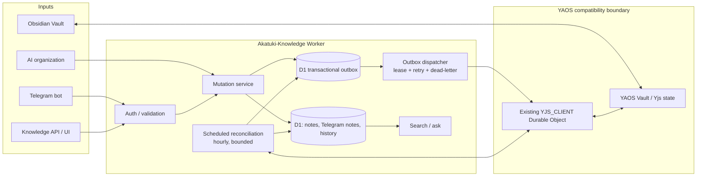
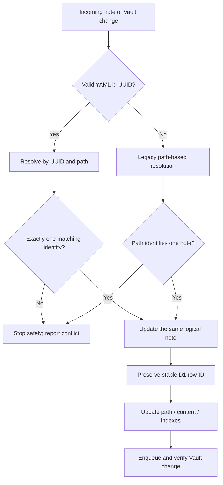

# Ideal sync architecture and feature contract

> Status: design target, not a statement that the current implementation is complete.
> Safety boundary: YAOS Worker / Durable Object protocol is treated as an external dependency. Do not change it without separate evidence and approval.

## Goals

- Obsidian Vault and Akatuki-Knowledge stay synchronized without requiring frequent full scans.
- User edits, Telegram actions, API mutations, and restores propagate as events.
- The existing Vault remains recoverable; ambiguous identity or concurrent edits must fail closed rather than silently overwrite data.
- Scheduled reconciliation repairs missed events. It is a safety net, not the primary sync mechanism.
- Preserve existing search, AI organization, history, Telegram, and note-management behavior.

## Component and data-flow diagram



**Important:** The diagram specifies the desired logical relationship. The exact supported request/WebSocket protocol between the dispatcher and the deployed YAOS Durable Object must be verified against deployed code before implementation is considered safe.

## Event write path

```mermaid
sequenceDiagram
  participant Client as Obsidian / Telegram / API
  participant W as Akatuki-Knowledge Worker
  participant D1 as D1
  participant Q as Outbox dispatcher
  participant Y as Existing YAOS adapter
  participant V as Vault / Yjs

  Client->>W: Create / edit / move / delete / restore
  W->>D1: Validate identity and persist mutation
  W->>D1: Insert outbox event in same transaction/batch
  W-->>Client: Return mutation result
  Q->>D1: Claim event with lease
  Q->>Y: Apply desired state + stable identity
  Y->>V: Update document and indexes
  Y->>V: Read back and verify
  Y-->>Q: Verified result
  Q->>D1: Mark event sent
  Note over Q,D1: Failures retry with backoff; exhausted events become inspectable dead letters
```

The note mutation and outbox record must be atomic where D1 transaction/batch semantics allow it. If an operation cannot be made atomic, it needs an explicit repair strategy and must not claim guaranteed delivery.

## Identity, rename, and conflict rules



- YAML `id:` is the cross-system stable identity; a file path is a mutable location, not identity.
- Preserve the existing D1 primary key on rename. Update path and relevant references only after auditing all foreign-key/reference tables.
- Duplicate UUIDs, conflicting path/UUID matches, and stale expected-content hashes must stop the write and surface a conflict.
- Never silently resolve conflicts with “last write wins”.
- New UUIDs must be generated once and persisted. Existing valid UUIDs must be preserved.
- Telegram notes need deterministic, collision-resistant Vault paths derived from a stable Telegram-note identity, not title alone.
- Delete should be an explicit tombstone with restore support; physical removal should require a separate retention policy.
- UUID backfill must first report duplicates and invalid IDs; only apply changes after a dry-run report and a recoverable backup.

## Functional contract

| Area | Required behavior | Verification |
|---|---|---|
| Obsidian → D1 | Import create/edit/move/delete without duplicate rows | Fixtures for new, edited, renamed, deleted, restored, and legacy notes |
| D1 → Obsidian | Propagate API and Telegram mutations | Real protocol test against isolated/staging Vault |
| Identity | Preserve UUID and D1 row identity across rename | Rename retains one row and one Vault document |
| Conflicts | Detect duplicate UUID and concurrent/stale edits | No overwrite; explicit conflict response |
| Outbox | Lease, retry, deduplicate, dead-letter, inspect, replay | Crash/retry/idempotency tests |
| Telegram | Create, append/capture, search/read, edit/correct, delete/undo | End-to-end tests for each action |
| Search / ask | Keep existing behavior and authorization | Regression tests against current examples |
| AI organization | Preserve existing metadata/content behavior and permissions | Regression tests; sync only actual content mutations |
| History / restore | Preserve revision and undo semantics | Edit-delete-restore history tests |
| Scheduled work | Bounded reconciliation and maintenance at observed hourly cadence | Missed-event recovery; runtime and API-budget checks |
| Operations | Health, queue depth, oldest pending age, dead-letter alerts | Observable status without exposing secrets or note contents |

## Rollout and rollback

1. Capture current Worker version/configuration, live D1 schema, migration ledger, and behavior baselines.
2. Recover the original D1 migrations and Durable Object migration declarations. Do not invent migration history.
3. Implement and test against a local/isolated D1 database and a staging-compatible YAOS endpoint.
4. Run a dry-run identity audit and compare counts/hashes before any backfill.
5. Deploy a compatible schema first only after migration compatibility is proven; then deploy code with a controlled rollout.
6. Verify create/edit/move/delete/restore, Telegram, search, scheduled recovery, and existing features.
7. Keep the previous Worker version available for Cloudflare rollback. **A Worker rollback does not undo D1 writes or schema migrations**; data changes need their own backup/restore plan.
8. If any verification fails, stop rollout, preserve logs, and roll back the Worker only if the previous version is compatible with the current schema.

## Current known gaps

- Original D1 migration SQL 0001–0007 and exact Durable Object migration declarations for tags v1–v5 have not been recovered in the repository.
- The proposed outbox migration is pending and must not be applied to production yet.
- The real YAOS Durable Object protocol and expected-content conflict behavior still require staging validation.
- The current feature branch's CI contract checks are being corrected; a passing static test alone is not production-readiness evidence.
- Production data and YAOS must remain unchanged during recovery and staging work.
